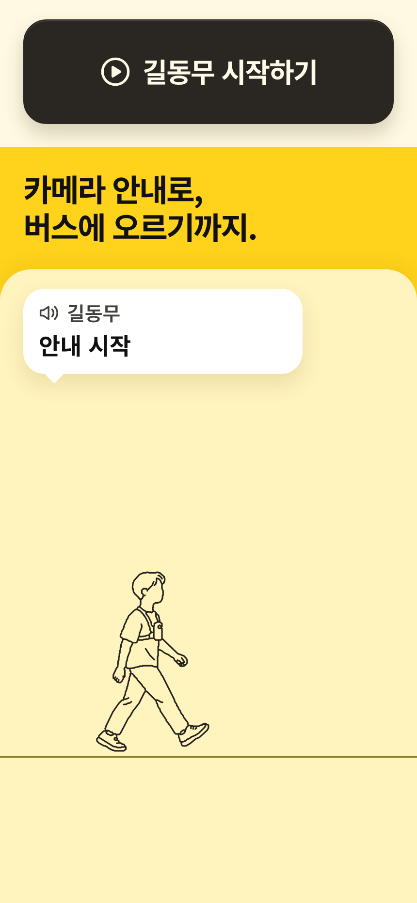
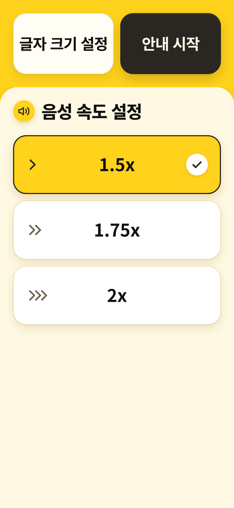
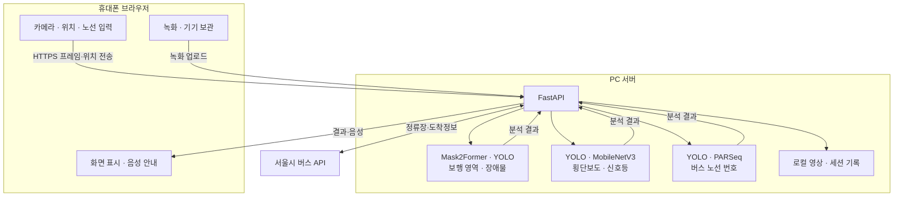

# 🦯 길동무 · Gildongmu

### AI 기반 보행 환경 인식 및 버스 탑승 보조 웹 앱

> **카메라 안내로, 버스에 오르기까지.**
> 휴대폰 카메라로 주변 환경을 인식하고, 보행과 버스 찾기에 필요한 정보를 음성으로 전달합니다.

<p align="center">
  
  
</p>
<p align="center">현재 앱의 시작 화면과 음성 속도 설정 화면</p>

길동무는 보행 가능 영역, 장애물, 횡단보도와 보행자 신호등을 하나의 카메라 화면에서 분석합니다.
버스 정류장에서는 GPS 기반 서울시 버스 도착정보와 카메라 기반 노선 번호 인식을 제공합니다.
휴대폰 브라우저가 촬영·화면 표시·음성 재생을 담당하고, PC 서버가 AI 모델 추론을 수행합니다.

[기술 스택](#-technologies--tools) · [프로젝트 목표](#-프로젝트-목표) · [주요 기능](#-주요-기능) · [시스템 구조](#-시스템-구조) · [실행 방법](#-실행-방법)

## 📝 Technologies & Tools

### Backend


### AI · Computer Vision


| 분석 대상 | 모델·기술 | 역할 |
| --- | --- | --- |
| 보행 가능 영역 | Mask2Former | 보도·횡단보도 영역 분할 |
| 장애물 | YOLO, BoT-SORT | 객체 검출·추적 및 보행 위험 판단 |
| 보행자 신호등 | YOLO, MobileNetV3-Small | 신호등 검출과 색상 분류 |
| 버스 노선 번호 | 버스·번호 영역 YOLO, PARSeq | 버스와 노선 번호 표시 영역 검출, 문자 인식 |

### Frontend


Canvas, Web Worker, MediaRecorder, IndexedDB, Geolocation, Web Speech API를 사용합니다.
별도 프론트엔드 빌드 없이 FastAPI가 정적 파일을 제공하므로 앱 실행에 Node.js는 필요하지 않습니다.

### Media · Connection


FFmpeg는 녹화 영상 변환과 음성 처리에, Cloudflare Tunnel은 휴대폰 HTTPS 접속에 사용합니다.
서버에서는 서울시 버스 도착정보 API와 동적 MP3 음성 합성을 연동합니다.
정확한 Python 패키지 버전은 [requirements.txt](requirements.txt)에서 관리합니다.

## 👥 Our Team

**4인 팀 프로젝트**로 보행 환경 인식, 신호 안내, 버스 번호 인식과 웹 앱을 통합했습니다.

## 🌈 프로젝트 목표

- **이동 상황에 필요한 정보 전달**: 보행 영역·장애물·신호·버스 노선 정보를 화면과 음성으로 안내합니다.
- **접근하기 쉬운 조작**: 큰 글자와 버튼, 음성 속도 조절, 버튼 설명 읽기와 두 번 탭 실행을 제공합니다.
- **휴대폰 브라우저로 이용**: 휴대폰에 모델을 설치하지 않고 카메라와 위치 정보를 PC 추론 서버에 전달합니다.

영상 기반 판단은 보조 정보이며, 실제 거리나 횡단 안전을 보장하지 않습니다.
카메라의 노선 번호 확인과 GPS 기반 버스 도착정보는 별도로 판단합니다.

## 🔧 주요 기능

<details open>
<summary><b>🚶 보행 영역·장애물 안내</b></summary>

- 보행 가능 영역을 분할하고 주변 장애물을 검출·추적합니다.
- 화면 내 위치와 시간에 따른 관측을 바탕으로 위험도를 판단합니다.
- 상황에 따라 정지·이동 방향·혼잡 안내를 음성으로 전달합니다.

</details>

<details>
<summary><b>🚦 횡단보도·신호등 안내</b></summary>

- 횡단보도와 보행자 신호등을 인식하고 신호 색상을 분류합니다.
- 횡단보도 관측과 신호 상태를 함께 사용해 음성 안내를 결정합니다.
- 횡단 중 정렬과 이탈 상태를 안내합니다.

</details>

<details>
<summary><b>🚌 버스 찾기·도착정보</b></summary>

- 큰 키패드 또는 음성으로 목표 노선을 입력합니다.
- GPS로 주변 정류장을 확인하고 정류장·방향을 선택합니다.
- 서울시 버스 API의 도착정보와 카메라의 노선 번호 인식을 함께 제공합니다.
- 버스 번호는 같은 차량에서 반복 확인한 관측을 사용해 판단합니다.

</details>

<details>
<summary><b>🔊 접근성·영상 기록</b></summary>

- 음성 속도와 글자 크기를 조절할 수 있습니다.
- 직접 터치 시 버튼을 한 번 누르면 설명을 읽고, 같은 버튼을 빠르게 두 번 누르면 실행합니다.
- 최대 90초 영상 1개를 기록하고 원본·분석 영상과 세션 로그를 저장합니다.
- 전송에 실패한 영상은 기기 보관본으로 재전송할 수 있습니다.

</details>

## 🧩 시스템 구조



## 💡 기술적 선택과 구현

| 구성 | 현재 구현 | 관련 코드 |
| --- | --- | --- |
| 웹 화면과 API 통합 | 같은 FastAPI 서버에서 웹 화면·API·안내 음원을 제공합니다. | [backend/app.py](backend/app.py) |
| 모델 재사용 | 첫 세션에 모델을 로딩하고 이후 세션에서는 추적 상태를 초기화합니다. | [backend/session.py](backend/session.py) |
| 브라우저 프레임 인코딩 | 지원 환경에서는 Web Worker·OffscreenCanvas를 사용하고, 미지원·실패 시 일반 Canvas로 전환합니다. | [frontend/js/camera.js](frontend/js/camera.js) |
| 비동기 버스 인식 | 별도 작업 스레드에서 최신 프레임을 처리하고 이전 노선·세션의 결과는 폐기합니다. | [backend/bus/recognition.py](backend/bus/recognition.py) |
| 녹화 보관과 복구 | IndexedDB에 녹화본을 보관하고, 서버 저장 완료를 확인한 뒤 기기 보관본을 정리합니다. | [frontend/js/clip-store.js](frontend/js/clip-store.js), [frontend/js/app.js](frontend/js/app.js) |

## 📂 프로젝트 구조

```text
gildongmu-app/
├── backend/                  # 실시간 API, 세션·녹화, 음성 처리
│   └── bus/                  # 버스 검출·OCR, 도착정보, 음성 합성
├── frontend/
│   ├── index.html            # 앱 진입 화면
│   ├── css/                  # 화면 스타일
│   ├── js/                   # 카메라, 안내, 접근성, 녹화
│   └── audio/voice/          # 한국어 안내 음원
├── src/                      # 보행·장애물·신호 추론 및 공통 설정
├── configs/                  # 서버·경로·추론·음성·버스 설정
├── scripts/                  # 서버 실행, 접속 설정, HTTPS 터널
├── docs/images/              # README용 실제 앱 화면
├── .env.example              # 환경변수 예제
└── requirements.txt          # 앱 실행 의존성
```

## 🚀 실행 방법

### 1. 실행 환경 준비

Linux 또는 Windows WSL의 Bash 환경과 Python 3.12를 사용합니다.
NVIDIA GPU 사용을 권장하며, `configs/inference.yaml`의 `device: auto`는 사용 가능한 CUDA 장치를 선택하고
없으면 CPU로 실행합니다. CPU에서는 처리 속도가 느려질 수 있습니다.

현재 로컬 환경의 주요 설치 버전은 Python **3.12.15**, PyTorch **2.14.0+cu130**,
torchvision **0.29.0+cu130**, Transformers **5.17.0**, Ultralytics **8.4.152**입니다.

Ubuntu 24.04 기준 시스템 라이브러리:

```bash
sudo apt update
sudo apt install -y git curl build-essential python3.12 python3.12-venv \
  libgl1 libglib2.0-0t64
```

Python 3.12와 `venv` 지원을 설치한 뒤 저장소 루트에서 가상환경을 준비합니다.
이미 소스를 받은 경우 복제 단계는 생략합니다.

```bash
git clone --branch dev https://github.com/ai-cv-prj/gildongmu-app.git
cd gildongmu-app
python3.12 -m venv .venv
source .venv/bin/activate
```

### 2. 패키지 설치

실행 환경에 맞는 PyTorch 명령 **하나**를 먼저 실행합니다.
GPU 명령은 CUDA 13.0을 지원하는 NVIDIA 드라이버가 준비된 환경 기준입니다.

```bash
# NVIDIA GPU
python -m pip install torch==2.14.0 torchvision==0.29.0 \
  --index-url https://download.pytorch.org/whl/cu130
```

```bash
# CPU
python -m pip install torch==2.14.0 torchvision==0.29.0 \
  --index-url https://download.pytorch.org/whl/cpu
```

나머지 실행 의존성을 설치합니다.

```bash
python -m pip install -r requirements.txt
python -m pip check
```

영상 변환용 FFmpeg는 `imageio-ffmpeg`가 제공합니다.
모델 가중치와 PARSeq 소스는 아래 경로에 별도로 준비해야 합니다.

### 3. 모델 파일 배치

`weights/`는 Git에 포함되지 않습니다. 프로젝트에서 사용하는 가중치와 해당 PARSeq 소스를
별도로 전달받아 배치합니다. 임의의 다른 모델 파일은 클래스 구성과 로딩 방식이 다를 수 있습니다.

```text
weights/
├── walking/
│   ├── mask2former/
│   │   ├── config.json
│   │   ├── preprocessor_config.json
│   │   └── model.safetensors
│   └── yolo/
│       └── yolo26n_pedestrian29_stop_v3.pt
├── traffic/
│   ├── best_YOLO_640.pt
│   └── best_MobileNet.pt
└── bus/
    ├── route-display-b.pt
    ├── yolo11n.pt
    ├── parseq-bb5792a6.pt
    └── parseq-src/          # hubconf.py, strhub/, configs/ 등을 포함한 PARSeq 소스
```

보행·신호등 모델 경로는 [configs/paths.yaml](configs/paths.yaml), 버스 모델 경로는
[configs/bus.yaml](configs/bus.yaml)에서 변경할 수 있습니다.
Mask2Former는 가중치뿐 아니라 모델·전처리 설정 파일도 필요합니다.
버스 모델이 없으면 번호 인식을 사용할 수 없으며, 보행·신호 안내는 독립적으로 동작합니다.

### 4. 환경변수 설정

처음 실행할 때 예제 파일을 복사합니다. 기존 `.env`가 있으면 필요한 값만 수정합니다.

```bash
cp -n .env.example .env
```

```dotenv
APP_HOST=127.0.0.1
APP_PORT=8001
SEOUL_BUS_API_KEY=
```

`SEOUL_BUS_API_KEY`는 서울시 버스 도착정보를 사용할 때 설정합니다.
키가 없어도 모델 파일이 준비되어 있으면 카메라 기반 버스 번호 인식은 사용할 수 있습니다.
버스 도착정보 조회와 동적 MP3 음성 합성에는 서버의 인터넷 연결이 필요합니다.
서버 주소·포트의 기본값은 `configs/app.yaml`에 있으며 환경변수가 우선합니다.
환경변수를 변경한 뒤에는 서버를 재시작합니다.

### 5. 서버 실행

```bash
./scripts/run.sh
```

PC에서 **http://127.0.0.1:8001**에 접속합니다. API 문서는 **http://127.0.0.1:8001/docs**에서 확인합니다.
직접 실행할 때는 같은 가상환경에서 다음 명령을 사용합니다.

```bash
python -m uvicorn backend.app:app --host 127.0.0.1 --port 8001 --workers 1
```

세션과 모델 상태를 프로세스 메모리에서 관리하므로 **단일 워커**로 실행합니다.
한 서버에서 동시에 진행할 수 있는 안내 세션은 하나입니다.

### 6. 휴대폰 접속

휴대폰 카메라·위치 권한을 사용하려면 HTTPS 접속이 필요합니다.
Linux/WSL **x86_64**에서는 `cloudflared`를 다음과 같이 설치할 수 있습니다.
이미 설치되어 있으면 이 단계는 생략합니다.

```bash
mkdir -p "$HOME/.local/bin"
curl -fL https://github.com/cloudflare/cloudflared/releases/latest/download/cloudflared-linux-amd64 \
  -o "$HOME/.local/bin/cloudflared"
chmod +x "$HOME/.local/bin/cloudflared"
export PATH="$HOME/.local/bin:$PATH"
cloudflared --version
```

서버가 실행 중인 상태에서 **다른 터미널**을 열어 실행합니다.
새 터미널에서 `cloudflared`를 찾지 못하면 위 `export PATH` 명령도 다시 실행합니다.

```bash
./scripts/tunnel.sh
```

출력되는 `https://…trycloudflare.com` 주소를 휴대폰 브라우저에서 엽니다.
서버와 터널 터미널은 사용하는 동안 켜 둡니다. 터널을 다시 실행하면 접속 주소가 달라질 수 있습니다.
코드를 수정해 앱 서버만 재시작할 때는 같은 주소·포트를 유지하고 터널 터미널을 그대로 두면 기존 접속 주소를 계속 사용할 수 있습니다.

1. **길동무 시작하기**에서 음성 속도와 글자 크기를 설정합니다.
2. **안내 시작**을 누르고 카메라 권한을 허용합니다.
3. 보행·신호 안내를 이용하고, 버스를 찾을 때 **버스 번호 입력**으로 이동합니다.
4. 키패드 또는 음성으로 노선을 입력하고 **버스 찾기**를 실행합니다. 도착정보에는 위치 권한도 필요합니다.
5. 사용을 마치면 **안내 종료**를 누릅니다.

휴대폰 직접 터치에서는 버튼을 한 번 누르면 설명을 읽고, 같은 버튼을 빠르게 두 번 누르면 실행합니다.
음성 입력과 카메라 세부 설정의 지원 여부는 브라우저·기기에 따라 다릅니다.

#### 고정 주소 사용 (선택)

Cloudflare 계정과 Cloudflare에 등록한 도메인이 있으면 터널을 재시작해도 같은 주소를 사용할 수 있습니다.
[Cloudflare 설정 안내](https://developers.cloudflare.com/tunnel/get-started/)에 따라 대시보드의
**Networking > Tunnels**에서 터널을 만들고, **Routes > Add route > Published application**으로
원하는 호스트 이름(예: `app.example.com`)을 앱 서버에 연결합니다.
**Service URL**은 기본 설정에서 `http://127.0.0.1:8001`이며, 앱 포트를 바꿨다면 같은 포트로 설정합니다.

터널 설치 명령에 포함된 토큰만 로컬 파일 `.local-only/cloudflare/app-token`에 저장합니다.
기존 터널의 토큰은 **Add a replica**에서 확인할 수 있습니다.
자세한 위치는 [터널 토큰 안내](https://developers.cloudflare.com/tunnel/reference/tunnel-tokens/)를 참고합니다.
토큰은 `.env`에 직접 넣지 않고, Git에서 제외된 위 경로에 소유자만 접근하도록 보관합니다.

```bash
umask 077
mkdir -p .local-only/cloudflare
nano .local-only/cloudflare/app-token
chmod 600 .local-only/cloudflare/app-token
```

`.env`에 아래 두 값을 모두 설정한 뒤 `./scripts/tunnel.sh`를 실행합니다.

```dotenv
CLOUDFLARE_TUNNEL_TOKEN_FILE=.local-only/cloudflare/app-token
CLOUDFLARE_TUNNEL_URL=https://app.example.com
```

두 값을 모두 비우면 기존 임시 주소 방식을 사용합니다. 스크립트는 Cloudflare의 호스트 이름·경로를 생성하지 않으므로 대시보드에서 먼저 연결해야 합니다.
고정 주소를 사용해도 PC가 꺼져 있으면 접속할 수 없습니다. PC를 다시 켜고 서버와 터널을 실행하면 같은 주소로 접속합니다.

## ⚙️ 설정 및 저장 위치

| 파일 | 관리하는 설정 |
| --- | --- |
| [configs/app.yaml](configs/app.yaml) | 서버 주소·포트, 카메라, 업로드·녹화, 세션 |
| [configs/paths.yaml](configs/paths.yaml) | 모델·음원·프론트엔드 및 세션 저장 경로 |
| [configs/inference.yaml](configs/inference.yaml) | 추론 장치, 검출·추적, 보행·횡단보도 판단 |
| [configs/audio.yaml](configs/audio.yaml) | 음성 속도·우선순위, 신호·보행 안내 시간 |
| [configs/bus.yaml](configs/bus.yaml) | 버스 모델, OCR 주기, 정류장 범위, 요청 제한 시간 |

설정을 변경하면 서버와 브라우저 화면을 다시 시작합니다.
기본 세션 저장 위치는 **`test-result/`**이며 `configs/paths.yaml`의 `session_dir`에서 지정합니다.
앱의 **영상 기록**에서 최대 90초 영상 1개를 기록할 수 있습니다.
세션 정보·분석 결과·이벤트는 `session.json`, `results.jsonl`, `events.jsonl`에 저장합니다.
녹화 완료 후에는 원본 영상과 분석 영상을 저장하고, 전송 실패 시 재전송 기능을 제공합니다.

## 🔎 문제 해결

| 증상 | 확인할 내용 |
| --- | --- |
| Python·패키지를 찾지 못함 | Python 3.12 설치, `.venv` 활성화, `python -m pip check` |
| 모델 로딩 실패 | `weights/` 파일 배치와 설정 경로, Mask2Former 설정 파일, PARSeq 소스 |
| 휴대폰 카메라가 열리지 않음 | HTTPS 주소, 카메라 권한, 다른 앱의 카메라 점유 여부 |
| 버스 도착정보가 나오지 않음 | API 키, 위치 권한, GPS 정확도, 주변 정류장·노선 여부 |
| 서버 포트가 사용 중임 | 기존 서버 확인 또는 `APP_PORT` 변경 후 서버·터널 재시작 |
| 녹화 전송 실패 | 연결 상태 확인 후 **영상 전송 다시 시도**, 기기에 보관한 원본 확인 |

`GET /api/health`로 서버 응답을, `GET /api/bus/status`로 버스 API 키·모델 파일 준비 상태를 확인할 수 있습니다.
버스 상태의 준비 표시는 실제 API 인증이나 모델 로딩 성공까지 검증하지는 않습니다.
