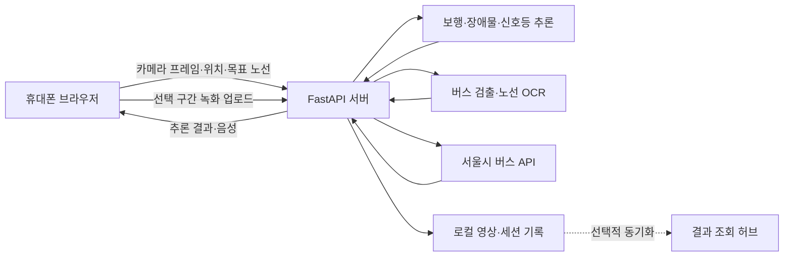

# 길동무 · Gildongmu

**휴대폰 카메라로 보행 환경을 인식하고, 음성으로 이동과 버스 찾기를 돕는 웹 앱입니다.**

카메라 영상에서 보행 가능 영역, 장애물, 횡단보도와 보행자 신호등을 분석합니다.
버스 정류장에서는 GPS 기반 서울시 버스 도착정보와 카메라 기반 노선 번호 인식을 함께 제공합니다.
AI 추론은 PC 서버에서 수행하며, 휴대폰 브라우저는 촬영·화면 표시·음성 안내를 담당합니다.

<p align="center">
  
  
</p>

<p align="center">현재 앱의 시작 화면과 음성 속도 설정 화면</p>

## 주요 기능

| 기능 | 내용 |
| --- | --- |
| 보행 안내 | 보행 가능 영역 분할, 장애물 검출·추적, 위험도에 따른 정지·방향 음성 안내 |
| 횡단보도·신호 안내 | 횡단보도 인식, 보행자 신호등 색상 판별, 횡단 중 정렬·이탈 안내 |
| 버스 찾기 | 큰 키패드·음성으로 목표 노선 입력, 버스 노선 번호 표시 영역 검출과 OCR로 노선 확인 |
| 정류장·도착정보 | GPS 기반 주변 정류장·방향 선택 및 서울시 버스 도착정보 안내 |
| 접근성 | 큰 글자, 음성 속도 조절, 터치 시 버튼 설명 및 두 번 탭하여 실행 |
| 영상 기록 | 원본·분석 영상과 세션 로그 저장, 전송 실패 시 기기 보관본 재전송 |
| 결과 조회 | 별도 결과 허브에서 여러 서버의 영상·분석 기록 조회·분류 |

영상 기반 안내는 보조 정보이며, 실제 거리나 횡단 안전을 보장하지 않습니다.
버스 번호 인식과 정류장 도착정보는 별도로 판단합니다.

## 기술 스택

| 영역 | 사용 기술 |
| --- | --- |
| 언어·실행 환경 | Python 3.12, JavaScript, HTML5, CSS3 |
| 웹 서버 | FastAPI, Uvicorn, Pydantic |
| 딥러닝 추론 | PyTorch, torchvision, Hugging Face Transformers, Ultralytics |
| 보행 영역·장애물 | Mask2Former, YOLO, BoT-SORT |
| 보행자 신호등 | YOLO, MobileNetV3-Small |
| 버스 번호 인식 | 버스·번호 영역 YOLO, PARSeq OCR |
| 영상·음성 처리 | OpenCV, NumPy, Pillow, FFmpeg (`imageio-ffmpeg`) |
| 브라우저 기능 | Canvas, Web Worker, MediaRecorder, IndexedDB, Geolocation, Web Speech API |
| 외부 연동 | 서울시 버스 API, 서버 MP3 음성 합성, Cloudflare Tunnel |
| 결과 허브 | FastAPI, SQLite, Docker Compose |

프론트엔드는 별도 빌드 없이 FastAPI가 정적 파일로 제공합니다. 앱 실행에 Node.js는 필요하지 않습니다.
패키지 버전은 [requirements.txt](requirements.txt), 허브 전용 버전은
[requirements-hub.txt](requirements-hub.txt)에서 관리합니다.

## 구성



```text
gildongmu-app/
├── backend/              # 실시간 API, 세션·녹화, 버스 서비스
│   └── bus/              # 버스 검출·OCR, 도착정보, 음성 합성
├── frontend/             # 웹 화면, JavaScript, 스타일, 안내 음원
├── src/                  # 보행·장애물·신호등 추론 및 안내 로직
├── configs/              # 서버·경로·모델·음성 설정
├── scripts/              # 앱 실행, HTTPS 터널, 영상 추론, 결과 동기화
├── result_hub/           # 결과 조회 서버 및 화면
├── docs/                 # 앱 화면 이미지 및 결과 허브 운영 안내
├── requirements.txt      # 앱 실행 의존성
├── requirements-hub.txt  # 결과 허브 실행 의존성
├── Dockerfile.hub
└── compose.hub.yaml
```

## 실행 방법

### 1. 실행 환경 준비

Linux 또는 Windows WSL의 Bash 환경과 Python 3.12를 사용합니다.
NVIDIA GPU 사용을 권장하며, `configs/inference.yaml`의 `device: auto`는 사용 가능한 CUDA 장치를 선택하고
없으면 CPU로 실행합니다. CPU에서는 처리 속도가 느려질 수 있습니다.

현재 로컬 환경의 주요 설치 버전은 Python **3.12.15**, PyTorch **2.14.0+cu130**,
torchvision **0.29.0+cu130**, Transformers **5.17.0**, Ultralytics **8.4.152**입니다.

Ubuntu 24.04 기준 시스템 라이브러리:

```bash
sudo apt update
sudo apt install -y git curl build-essential python3.12 python3.12-venv \
  libgl1 libglib2.0-0t64 fonts-noto-cjk
```

Python 3.12와 `venv` 지원을 설치한 뒤 저장소 루트에서 가상환경을 준비합니다.
이미 소스를 받은 경우 복제 단계는 생략합니다.

```bash
git clone --branch dev https://github.com/ai-cv-prj/gildongmu-app.git
cd gildongmu-app
python3.12 -m venv .venv
source .venv/bin/activate
```

### 2. 패키지 설치

실행 환경에 맞는 PyTorch 명령 **하나**를 먼저 실행합니다.
GPU 명령은 CUDA 13.0을 지원하는 NVIDIA 드라이버가 준비된 환경 기준입니다.

```bash
# NVIDIA GPU
python -m pip install torch==2.14.0 torchvision==0.29.0 \
  --index-url https://download.pytorch.org/whl/cu130
```

```bash
# CPU
python -m pip install torch==2.14.0 torchvision==0.29.0 \
  --index-url https://download.pytorch.org/whl/cpu
```

나머지 실행 의존성을 설치합니다.

```bash
python -m pip install -r requirements.txt
python -m pip check
```

영상 변환용 FFmpeg는 `imageio-ffmpeg`가 제공합니다.
모델 가중치와 PARSeq 소스는 아래 경로에 별도로 준비해야 합니다.

### 3. 모델 파일 배치

`weights/`는 Git에 포함되지 않습니다. 프로젝트에서 사용하는 가중치와 해당 PARSeq 소스를
별도로 전달받아 배치합니다. 임의의 다른 모델 파일은 클래스 구성과 로딩 방식이 다를 수 있습니다.

```text
weights/
├── walking/
│   ├── mask2former/
│   │   ├── config.json
│   │   ├── preprocessor_config.json
│   │   └── model.safetensors
│   └── yolo/
│       └── yolo26n_pedestrian29_stop_v3.pt
├── traffic/
│   ├── best_YOLO_640.pt
│   └── best_MobileNet.pt
└── bus/
    ├── route-display-b.pt
    ├── yolo11n.pt
    ├── parseq-bb5792a6.pt
    └── parseq-src/          # hubconf.py, strhub/, configs/ 등을 포함한 PARSeq 소스
```

보행·신호등 모델 경로는 [configs/paths.yaml](configs/paths.yaml), 버스 모델 경로는
[configs/bus.yaml](configs/bus.yaml)에서 변경할 수 있습니다.
Mask2Former는 가중치뿐 아니라 모델·전처리 설정 파일도 필요합니다.
버스 모델이 없으면 번호 인식을 사용할 수 없으며, 보행·신호 안내는 독립적으로 동작합니다.

### 4. 환경변수 설정

처음 실행할 때 예제 파일을 복사합니다. 기존 `.env`가 있으면 필요한 값만 수정합니다.

```bash
cp -n .env.example .env
```

```dotenv
APP_HOST=127.0.0.1
APP_PORT=8001
SEOUL_BUS_API_KEY=
```

`SEOUL_BUS_API_KEY`는 서울시 버스 도착정보를 사용할 때 설정합니다.
키가 없어도 모델 파일이 준비되어 있으면 카메라 기반 버스 번호 인식은 사용할 수 있습니다.
버스 도착정보 조회와 동적 MP3 음성 합성에는 서버의 인터넷 연결이 필요합니다.
서버 주소·포트의 기본값은 `configs/app.yaml`에 있으며 환경변수가 우선합니다.
환경변수를 변경한 뒤에는 서버를 재시작합니다.

### 5. 서버 실행

```bash
./scripts/run.sh
```

PC에서 **http://127.0.0.1:8001**에 접속합니다. API 문서는 **http://127.0.0.1:8001/docs**에서 확인합니다.
직접 실행할 때는 같은 가상환경에서 다음 명령을 사용합니다.

```bash
python -m uvicorn backend.app:app --host 127.0.0.1 --port 8001 --workers 1
```

세션과 모델 상태를 프로세스 메모리에서 관리하므로 **단일 워커**로 실행합니다.
한 서버에서 동시에 진행할 수 있는 안내 세션은 하나입니다.

### 6. 휴대폰 접속

휴대폰 카메라·위치 권한을 사용하려면 HTTPS 접속이 필요합니다.
Linux/WSL **x86_64**에서는 `cloudflared`를 다음과 같이 설치할 수 있습니다.
이미 설치되어 있으면 이 단계는 생략합니다.

```bash
mkdir -p "$HOME/.local/bin"
curl -fL https://github.com/cloudflare/cloudflared/releases/latest/download/cloudflared-linux-amd64 \
  -o "$HOME/.local/bin/cloudflared"
chmod +x "$HOME/.local/bin/cloudflared"
export PATH="$HOME/.local/bin:$PATH"
cloudflared --version
```

서버가 실행 중인 상태에서 **다른 터미널**을 열어 실행합니다.
새 터미널에서 `cloudflared`를 찾지 못하면 위 `export PATH` 명령도 다시 실행합니다.

```bash
./scripts/tunnel.sh
```

출력되는 `https://…trycloudflare.com` 주소를 휴대폰 브라우저에서 엽니다.
서버와 터널 터미널은 사용하는 동안 켜 둡니다. 터널을 다시 실행하면 접속 주소가 달라질 수 있습니다.

1. **길동무 시작하기**에서 음성 속도와 글자 크기를 설정합니다.
2. **안내 시작**을 누르고 카메라 권한을 허용합니다.
3. 보행·신호 안내를 이용하고, 버스를 찾을 때 **버스 번호 입력**으로 이동합니다.
4. 키패드 또는 음성으로 노선을 입력하고 **버스 찾기**를 실행합니다. 도착정보에는 위치 권한도 필요합니다.
5. 사용을 마치면 **안내 종료**를 누릅니다.

휴대폰 직접 터치에서는 버튼을 한 번 누르면 설명을 읽고, 같은 버튼을 빠르게 두 번 누르면 실행합니다.
음성 입력과 카메라 세부 설정의 지원 여부는 브라우저·기기에 따라 다릅니다.

## 설정과 저장 위치

| 파일 | 관리하는 설정 |
| --- | --- |
| [configs/app.yaml](configs/app.yaml) | 서버 주소·포트, 카메라, 업로드·녹화, 세션 |
| [configs/paths.yaml](configs/paths.yaml) | 모델·음원·프론트엔드 및 입력·출력 경로 |
| [configs/inference.yaml](configs/inference.yaml) | 추론 장치, 검출·추적, 보행·횡단보도 판단 |
| [configs/audio.yaml](configs/audio.yaml) | 음성 속도·우선순위, 신호·보행 안내 시간 |
| [configs/bus.yaml](configs/bus.yaml) | 버스 모델, OCR 주기, 정류장 범위, 요청 제한 시간 |

설정을 변경하면 서버와 브라우저 화면을 다시 시작합니다.
기본 세션 저장 위치는 **`test-result/`**이며 `configs/paths.yaml`의 `session_dir`에서 지정합니다.
화면의 **테스트 도구 → 영상 기록**은 현재 앱에 포함된 녹화 기능으로, 최대 90초 영상 1개를 기록합니다.
세션 정보·분석 결과·이벤트는 `session.json`, `results.jsonl`, `events.jsonl`에 저장합니다.
녹화 완료 후에는 원본 영상과 분석 영상을 저장하고, 전송 실패 시 재전송 기능을 제공합니다.

### 저장 영상 추론

실시간 카메라 외에 로컬 MP4·WebM 파일도 처리할 수 있습니다.

```bash
python -m scripts.run_video_inference --video-path data/samples/input/sample1/input.mp4
python -m scripts.run_bus_video_inference --sample-dir data/samples/input/sample1 --target-route 143
```

기본 출력 위치는 `data/samples/output/`입니다. 각 명령의 `--help`로 입력·출력·모델 옵션을 확인합니다.

### 결과 허브 실행 · 선택 사항

여러 서버의 영상과 분석 기록을 모아 볼 때 사용합니다. 허브에는 GPU와 모델 가중치가 필요하지 않습니다.
Docker와 Compose를 준비한 뒤 실행합니다.

```bash
python -m scripts.init_hub_env
docker compose --env-file .env.hub -f compose.hub.yaml up -d --build
```

기본 조회 주소는 **http://127.0.0.1:8080**입니다. 생성된 `.env.hub`의 조회 계정으로 로그인합니다.
서버별 동기화와 운영 방법은 [결과 허브 안내](docs/result_hub.md)를 참고합니다.

## 문제 해결

| 증상 | 확인할 내용 |
| --- | --- |
| Python·패키지를 찾지 못함 | Python 3.12 설치, `.venv` 활성화, `python -m pip check` |
| 모델 로딩 실패 | `weights/` 파일 배치와 설정 경로, Mask2Former 설정 파일, PARSeq 소스 |
| 휴대폰 카메라가 열리지 않음 | HTTPS 주소, 카메라 권한, 다른 앱의 카메라 점유 여부 |
| 버스 도착정보가 나오지 않음 | API 키, 위치 권한, GPS 정확도, 주변 정류장·노선 여부 |
| 서버 포트가 사용 중임 | 기존 서버 확인 또는 `APP_PORT` 변경 후 서버·터널 재시작 |
| 녹화 전송 실패 | 연결 상태 확인 후 **영상 전송 다시 시도**, 기기에 보관한 원본 확인 |

`GET /api/health`로 서버 응답을, `GET /api/bus/status`로 버스 API 키·모델 파일 준비 상태를 확인할 수 있습니다.
버스 상태의 준비 표시는 실제 API 인증이나 모델 로딩 성공까지 검증하지는 않습니다.

## 소스 제출 범위

Git에는 앱 소스, 설정 예제, 실행 스크립트, 화면·음원 리소스와 운영 문서를 포함합니다.
가상환경, 비밀 환경변수, 모델 가중치, 촬영 데이터와 실행 결과는 `.gitignore`로 제외합니다.
테스트·평가 도구, 과거 보고서와 설계 시안은 로컬 `.local-only/`에 보관하며 제출에 포함하지 않습니다.
